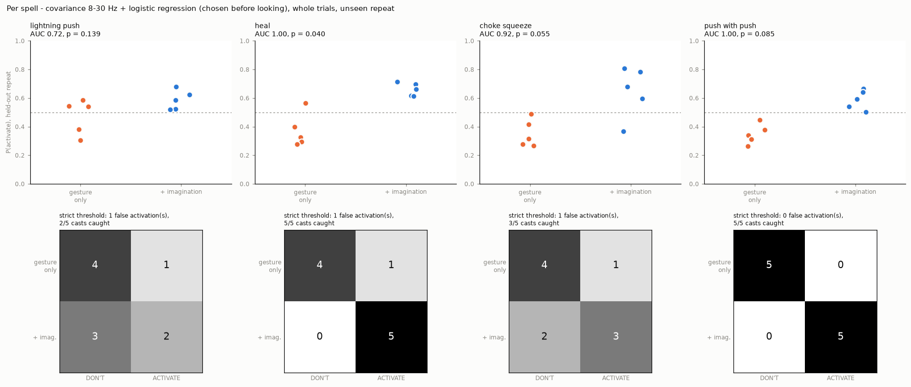

# EEG gating – the ability fires only when you *imagine* it

The camera recognises **which** gesture the player makes. A g.tec **BCI Core-8**
EEG headset decides **whether** the player is also doing the imaginary trigger
for that spell. Only gesture **+** imagination fires the ability; the same
gesture without imagination does nothing.

```
camera ── MediaPipe ── gesture classifier ──┐
                                            ├── SpellGate ── ability events ── TCP ── Unity
BCI Core-8 ── gpype ── per-spell EEG models ┘
```

## Abilities

| Camera gesture | EEG model | Kind | Events sent to Unity |
|---|---|---|---|
| `Push` | `push_with_push` | instant | `ability_triggered` – once per gesture |
| `Heal` | `heal` | held | `ability_started` … `ability_ended` – lasts while the gesture lasts |
| `Choke` | `choke_squeeze` | held | `ability_started` … `ability_ended` |
| `Lightning` | `lightning_push` | held | `ability_started` … `ability_ended` |

Only these events are sent – no per-frame stream, no raw gestures.

## Install

```bash
pip install -r requirements.txt            # camera side (project root)
pip install -r eeg/requirements-eeg.txt    # EEG side
```

`scikit-learn` must stay at the version in `requirements-eeg.txt`, otherwise the
pickled models in `eeg/models/live_models.joblib` may not load.

## Run

```bash
# headset + camera -> Unity (default)
python integrations/gesture_pipeline.py --host 127.0.0.1 --port 5555

# no Unity, print the events
python integrations/gesture_pipeline.py --dry_run

# no headset: camera only, same new events (mode "cv")
python integrations/gesture_pipeline.py --eeg off

# plumbing test with a simulated (random) EEG signal
python integrations/gesture_pipeline.py --eeg sim --dry_run

# old protocol (gesture_started / gesture_ended, camera only)
python integrations/gesture_pipeline.py --legacy_events
```

Before playing: wet/gel the electrodes and run `python -m eeg.tools.check_signal`
(see [`TROUBLESHOOTING.md`](TROUBLESHOOTING.md)). Check that every channel has contact. The
preview window shows `EEG 82%: contact OK` in green; in red it names the
electrode (e.g. `Cz not touching`). The models use **Fz, Cz, C4, PO7, POz,
PO8** – if one of those has no contact, abilities are blocked (or camera-only
with `--eeg_fallback cv`).

A panel to the right of the camera preview shows three predictions side by side:

* **CAMERA** – the gesture classifier's probability for every class.
* **EEG** – headset status and, for every ability, the mean P(imagination) of
  the last `--eeg_display_windows` windows (default 4) with the model's
  threshold as a white line; green = above the threshold. This is continuous,
  independent of the current gesture.
* **COMBINED** – `cv^w * eeg^(1-w)` per ability (`w = --fusion_cv_weight`),
  where the EEG score is rescaled so that the model's threshold = 0.5. It is
  high only when both agree; without EEG it equals the camera. The best ability
  above `--fusion_threshold` is shown as `PREDICTION`.
* **UNITY** – what the gate actually decided for the current gesture (EEG score
  since gesture start vs threshold, `waiting for EEG` / `ACTIVE` / `FIRED`).
  The combined prediction is for display only and reacts sooner; events sent to
  Unity still come from the gate and its anti-flicker rules.

`--no_panel` restores the old in-image overlay.

## Options

| Option | Default | Meaning |
|---|---|---|
| `--eeg` | `headset` | `headset`, `sim` (random signal), `off` (camera only) |
| `--eeg_serial` | `U8-2025.08.21` | headset serial number |
| `--eeg_model` | `eeg/models/live_models.joblib` | trained models + thresholds |
| `--eeg_fallback` | `block` | EEG unavailable (no data / electrode off): `block` = no abilities, `cv` = camera only |
| `--eeg_min_windows` | `6` | held abilities: EEG windows (one per 0.25 s) needed before starting |
| `--eeg_min_windows_push` | `3` | push: EEG windows needed before triggering |
| `--eeg_threshold_offset` | `0.0` | added to every model threshold (`+0.05` = fewer false activations, fewer catches) |
| `--eeg_release` | `1.5` | s below `threshold - 0.10` after which a held ability ends even though the gesture continues; `0` = only the gesture ends it |
| `--cv_stable` | `0.15` | s a camera gesture must be stable before it counts |
| `--cv_grace` | `0.35` | camera drop-outs shorter than this are ignored |
| `--cv_rejoin` | `1.0` | the same gesture returning within this after a longer drop-out continues the same gesture (EEG keeps adding up, Push does not fire twice) |
| `--decision` | `gate` | `gate` = `SpellGate` (below); `instant` = `InstantEEGCheck`, see *Instant check* |
| `--eeg_check_windows` | `4` | `--decision instant`: windows averaged at the moment of detection |
| `--legacy_events` | – | old `gesture_started` / `gesture_ended` protocol, no EEG |
| `--calibrate N` | `0` | in-game calibration: N prompted trials with and N without imagination per ability, recorded to `eeg/data/game/` ([`TRAINING.md`](TRAINING.md)) |
| `--calibrate_abilities` | all | `--calibrate`: only these abilities |
| `--eeg_record` | – | record EEG + camera gestures while playing; `y` / `n` in the preview labels the last gesture |
| `--record_label` | `none` | `--eeg_record`: label for gestures not labelled by key (`imagination` / `only`) |
| `--record_dir` | `eeg/data/game` | where in-game recordings go |
| `--no_panel` | – | no prediction panel next to the preview |
| `--fusion_cv_weight` | `0.5` | panel: camera weight in the combined score (0..1) |
| `--fusion_threshold` | `0.5` | panel: minimum combined score for a prediction |
| `--eeg_display_windows` | `4` | panel: EEG windows averaged for the EEG bars |

### Speed vs false activations

Replaying the four recorded sessions through the live code (simulated camera,
real EEG; these sessions trained the models, so real-world rates will be worse):

| held: windows | decision after gesture start | caught | false activations | push: windows | decision | caught | false |
|---|---|---|---|---|---|---|---|
| 4 | 1.9 s | 40/45 | 8/45 | 2 | 1.5 s | 24/25 | 6/25 |
| **6 (default)** | **2.4 s** | **40/45** | **4/45** | **3 (default)** | **1.7 s** | **23/25** | **5/25** |
| 8 | 2.9 s | 40/45 | 3/45 | 4 | 2.0 s | 23/25 | 4/25 |

## Instant check (`--decision instant`)

`eeg/instant_check.py` – an alternative to the gate, one decision per gesture:

1. the camera detects a movement (stable for `--cv_stable` s; drop-outs shorter
   than `--cv_grace` s are ignored),
2. at that moment the logistic-regression score of **that** movement is taken:
   the mean P(imagination) of the last `--eeg_check_windows` EEG windows
   (thresholds include `--eeg_threshold_offset`),
3. score ≥ threshold → the TCP event is sent (`ability_triggered` for Push,
   `ability_started` … `ability_ended` for held abilities, ended when the
   gesture is released); score < threshold → the movement is ignored until the
   gesture ends and the console prints `[EEG check] Choke zignorowany - EEG 0.32 < próg 0.55`.

No EEG data / electrode off: ignored (`--eeg_fallback block`) or sent
(`--eeg_fallback cv`). Events carry `"decision": "instant"`. It reacts right
away (≈ `--cv_stable` after the gesture starts) but judges the EEG from just
before the detection, so the imagination has to start together with (or
before) the movement. `--eeg_min_windows*`, `--eeg_release` and `--cv_rejoin`
do not apply. The panel shows `UNITY: <ability> IGNORED (below threshold)`.

## Anti-flicker (what keeps abilities from blinking)

* **Camera:** a gesture counts after `--cv_stable` s of stable recognition;
  gaps (wrong label, `inactive`, lost hand) shorter than `--cv_grace` s are
  ignored, so a held ability never stops on a few bad frames. This sits on top
  of the classifier's own `--gesture_cooldown`.
* **Camera fragments:** if the classifier breaks one gesture into pieces with
  longer gaps, a piece of the same gesture within `--cv_rejoin` s continues it:
  the EEG evidence keeps adding up (a held ability can still start) and a Push
  that already fired does not fire again. (Seen in a real run: Choke recognised
  as 0.36 s + 0.70 s pieces.)
* **EEG start:** the score is the mean P(imagination) of all 1 s windows since
  the gesture began (max 16 = 4 s, as in training) – never a single window.
* **EEG while held:** the ability stays on while the gesture lasts. The EEG can
  end it early only if the mean of the last 8 windows stays below
  `threshold - 0.10` for `--eeg_release` s (and not in the first 1 s). Short dips
  are ignored; after such an end it can restart in the same gesture after 0.5 s.
* **Push:** fires once per gesture; a quick push still fires up to 1 s after the
  hand dropped, using EEG that started during the gesture.

## TCP events

One JSON object per line (UTF-8, `\n`-terminated), same transport as before.

```json
{"event": "ability_started", "timestamp": 1794710652.249, "ability": "Choke", "kind": "sustained", "mode": "eeg", "cv_confidence": 0.95, "since_gesture_start": 2.41, "eeg_score": 0.66, "eeg_threshold": 0.58, "eeg_windows": 6}
{"event": "ability_ended", "timestamp": 1794710656.416, "ability": "Choke", "kind": "sustained", "mode": "eeg", "cv_confidence": 0.95, "since_gesture_start": 4.34, "eeg_score": 0.62, "eeg_threshold": 0.58, "eeg_windows": 15, "reason": "gesture_released", "duration": 1.9}
{"event": "ability_triggered", "timestamp": 1794710658.909, "ability": "Push", "kind": "instant", "mode": "eeg", "cv_confidence": 0.95, "since_gesture_start": 1.72, "eeg_score": 0.71, "eeg_threshold": 0.56, "eeg_windows": 3}
```

| Field | Meaning |
|---|---|
| `event` | `ability_triggered` (instant), `ability_started` / `ability_ended` (held) |
| `ability` | `Push`, `Heal`, `Choke`, `Lightning` – same names as the camera gestures |
| `kind` | `instant` or `sustained` |
| `mode` | `eeg` = confirmed by EEG; `cv` = camera only (`--eeg off` or `--eeg_fallback cv`) |
| `reason` (`ability_ended`) | `gesture_released`, `imagination_lost` (EEG dropped while holding), `shutdown` |
| `duration` (`ability_ended`) | seconds the ability was active |
| `eeg_score`, `eeg_threshold`, `eeg_windows` | EEG evidence (only in `mode: eeg`) |
| `cv_confidence`, `since_gesture_start` | camera confidence, seconds since the gesture began |

Every `ability_started` is followed by exactly one `ability_ended` for the same
ability (also on shutdown). Unity example (`JsonUtility`):

```csharp
[System.Serializable]
public class AbilityEvent {
    public string @event;      // "ability_started" | "ability_ended" | "ability_triggered"
    public string ability;     // "Push" | "Heal" | "Choke" | "Lightning"
    public string kind, mode, reason;
    public float duration, eeg_score, eeg_threshold;
}
// per line from the TCP stream:
var e = JsonUtility.FromJson<AbilityEvent>(line);
switch (e.@event) {
    case "ability_triggered": Cast(e.ability); break;          // Push
    case "ability_started":   StartChannel(e.ability); break;  // Heal / Choke / Lightning
    case "ability_ended":     StopChannel(e.ability); break;
}
```

## Files

| File | What |
|---|---|
| `spell_gate.py` | camera + EEG decision logic and anti-flicker (no hardware) |
| `instant_check.py` | `--decision instant`: EEG score checked once when the camera detects a movement (no hardware) |
| `fusion.py` | continuous camera / EEG / combined prediction for the preview panel (no hardware) |
| `headset.py` | BCI Core-8 / simulator via gpype, scoring windows, contact check |
| `features.py` | filter + features, identical to training |
| `models/live_models.joblib` | logistic regression per spell, thresholds, channel list |
| `tests/test_spell_gate.py` | `python -m eeg.tests.test_spell_gate` – 13 logic tests |
| `tests/test_instant_check.py` | `python -m eeg.tests.test_instant_check` – instant-check tests |
| `tests/test_fusion.py` | `python -m eeg.tests.test_fusion` – combined-prediction tests |
| `tests/smoke_pipeline.py` | `python -m eeg.tests.smoke_pipeline` – whole pipeline, fake camera, gpype, TCP |
| `tools/replay_recording.py` | `python -m eeg.tools.replay_recording rec.csv` – real EEG recording through the live path |
| `train.py` | `python -m eeg.train list / fit / calibrate / evaluate` – retrain on all data, calibrate thresholds ([`TRAINING.md`](TRAINING.md)) |
| `dataset.py` | recordings (cued + in-game) → labelled feature windows, `eeg/data/manifest.json` |
| `recorder.py` | in-game recording + `--calibrate` prompts (no hardware) |
| `data/` | training recordings (`.csv.gz`), `data/game/` = in-game recordings |
| `tools/record_spells.py` | `python -m eeg.tools.record_spells` – cued recording session without camera |
| `tools/check_signal.py` | `python -m eeg.tools.check_signal [--watch]` – electrode contact, noise, hum, alpha test |
| `tools/doctor.py` | `python -m eeg.tools.doctor [--scan] [--headset]` – packages, model, data, Bluetooth, headset stream |
| `tests/test_training.py` | `python -m eeg.tests.test_training` – recorder, calibration, fit / calibrate / evaluate |

## Recorded confusion matrices

Original offline results from the single-player session `spells_20261114_232939`:



The confusion matrices are in the bottom row: actual **gesture only / + imagination** versus predicted **DON'T / ACTIVATE**, five trials per condition and ability. These historical held-out-repeat results are separate from the live replay rates above and do not measure performance on new players.

See [recorded results](RESULTS.md) for full-size figures, saved numerical results, the archived `noC4` comparison, and the exploratory classifier comparison.

## The models

One logistic regression per spell on the log-covariance (8–30 Hz) of 1 s EEG
windows from Fz, Cz, C4, PO7, POz, PO8, trained on four sessions of one player
(gesture with vs without imagination; 15–25 trials per class and spell).
Thresholds are set for ~10 % false activations on held-out trials. The models
are **personal** – another player needs their own recordings and retraining.

To retrain on all data, add in-game data or re-calibrate the thresholds when the
signal changes, see [`TRAINING.md`](TRAINING.md). For connection and electrode problems, see
[`TROUBLESHOOTING.md`](TROUBLESHOOTING.md).
