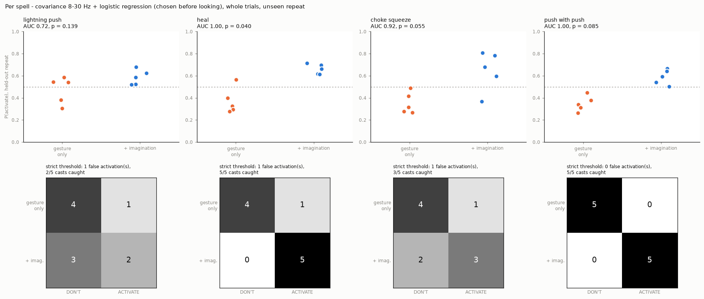
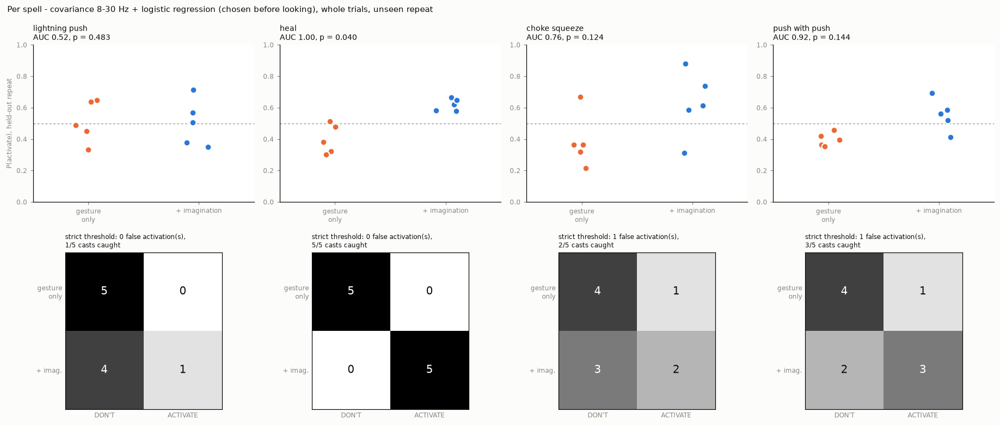
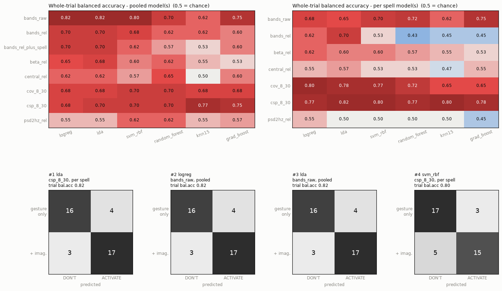

# Recorded EEG results

These are the original saved figures from `claude-workshop/plots/`, copied without altering the images or recomputing the experiments. The adjacent CSV files contain the saved numerical results; [provenance.json](results/provenance.json) records source paths and SHA-256 hashes.

The figures below concern the single-player recording `spells_20261114_232939` (gel electrodes; Pz flat, as noted in [TRAINING.md](TRAINING.md#data)). They compare **gesture only** against **gesture + imagination**, not the four gesture classes against each other. They are historical offline experiments, not measurements of the current live model, camera recognition accuracy, or performance on new players.

## Per-ability confusion matrices

[Open full-size figure](results/spells_20261114_232939_per_spell.png) · [Saved results CSV](results/spells_20261114_232939_per_spell.csv)

The bottom row contains the confusion matrices for Lightning, Heal, Choke, and Push. Rows are the actual condition (**gesture only**, **+ imagination**); columns are the predicted decision (**DON'T**, **ACTIVATE**). Each matrix contains five trials per condition. A false activation is the top-right cell; a missed imagined activation is the bottom-left cell.

The analysis used a predefined pipeline: 8–30 Hz covariance features and logistic regression, evaluated on whole trials with leave-one-repeat-out validation. The stricter decision threshold was selected within each training fold using nested validation. The AUC and permutation-test values are printed above the score plots. The dashed 0.5 line in the top row is a reference score, not the fold-specific strict decision threshold used in the matrices.

## Archived `noC4` comparison

[Open full-size figure](results/spells_20261114_232939_per_spell_noC4.png) · [Saved results CSV](results/spells_20261114_232939_per_spell_noC4.csv)

This is the separately saved `noC4` variant from the same recording. It is retained under its original filename so the comparison remains visible. Its CSV confirms different scores and confusion counts; the filename alone is not a complete record of the experimental configuration.

## Exploratory model comparison

[Open full-size figure](results/spells_20261114_232939_ml.png) · [Saved model-ranking CSV](results/spells_20261114_232939_ml_results.csv)

The upper panels compare whole-trial balanced accuracy across feature sets and classifiers. The lower panels show confusion matrices for four selected high-ranking configurations, each aggregated over 40 trials (20 per condition). These configurations were selected after comparing many alternatives, so their scores are optimistic. This is an exploratory comparison rather than independent confirmation of the selected model.

The per-ability results above and this model-ranking figure use different model/threshold choices. Their confusion counts should not be combined with the live replay rates in [README.md](README.md#speed-vs-false-activations), or interpreted as a new evaluation of the four-session model.
